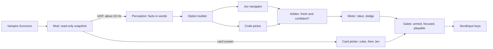

# Roadmap: how we get to 30:00

This is the living half of the project's guidance: architecture, phases, open questions, and a log of decisions. It is expected to change as we learn. The goal, philosophy, and hard boundaries live in [CHARTER.md](CHARTER.md). If a change here would contradict the charter, stop and discuss it first.

**Status (2026-10-24):** the navigator is in the bridge. Live play is still `baseline` unless you pass `--controller`. The mod now publishes `EnemyController.EnemyType` on enemies and bosses. HP, ids, and card offers are still not read ([open questions 4-6](#open-questions)). Mad Forest types missing from the unchecked wiki table stay "toughness unknown", so a full `code` vs `baseline` benchmark still waits on a live recording. Phase 0's latency numbers remain blocked on an API key ([open question 1](#open-questions)). See the [PR #1 review](reviews/pr-1-navigator.md).

**How to update this file:** when a phase finishes or a plan changes, update the status line, edit the affected section, and add a dated entry to the [decision log](#decision-log). Do not delete old decisions. Add a new entry that supersedes them.

## Where we are today

**What works, and stays:**

- **The mod.** A BepInEx plugin in `src/VampireSurvivorsJev.Mod` reads the game (version 1.16.107 on this machine) and sends a JSON snapshot over localhost UDP about 20 times a second. Live snapshots are `contracts/game-state.v5.schema.json`. v4 recordings still parse. A snapshot contains:
  - a **3×8 polar grid** of enemy, XP, and wall occupancy. That is 3 distance rings × 8 compass sectors around the player, scaled to the camera view. Wall cells come from the stage's collision tiles (the **wall channel**).
  - gem piles in world space (`xp_piles`), clustered from the same gem read as the XP grid.
  - up to 8 nearby enemies with velocity and, when the probe is on, an `EnemyType` name. No HP and no per-enemy id yet;
  - bosses, chests, pickups (such as the floor chicken), and destructibles (such as braziers);
  - the player's HP, level, XP, magnet, facing, weapons, and **body blocked flags** (the physics engine's report of which sides the player is pressed against this frame).
- **The overlay.** `src/VampireSurvivorsJev.Overlay` is a separate process with a status panel and a field display drawn over the game window. It reads local files that the mod and the bridge write.
- **The bridge plumbing.** `bridge/vampirejev` contains the receiver, the arm, focus, and pause gates, WASD output through `SendInput`, a small arena simulator (`sim.py`), a recording replayer (`replay.py`), and unit tests. The mod can also save raw snapshots to a JSONL recording (`Telemetry.RecordJsonl`).

**What does not work: the decision layer.** Today's pilot (`policy.py` + `pilot.py`) scores eight headings with hand-tuned weights. It switches between four **modes** (farm, kite, flee, chest) and uses terms such as priced contact, openness, and kiting; `bridge/README.md` explains each one. It survives less than five minutes, and the owner picks every upgrade card by hand. It falls behind for two reasons:

- **Weapon aim switches off exactly when it is needed.** `kill_appetite = (1.0 - phase) if hp_ratio > 0.5 else 0.0`, where `phase` is a 0–1 dial that rises with time and enemy count. So as the screen fills (or HP dips) the whip and knife bonus goes to zero, while the threat weight grows. The bot gets more avoidant as it needs to clear more.
- **Every enemy looks the same.** Enemies are anonymous counts (bins, plus 8 nearby bodies with no type and no HP). A bat that dies to garlic and a tank that walks through it are the same number. So the bot runs from everything, kills fall behind spawns, levels stall, and the next minute is worse.

Neither problem can be fixed by a model until the snapshot carries the missing facts. That is why new game reads come before Jev movement in the phases below.

## Target architecture



### Two clocks

- **The fast loop runs on every snapshot, about 20 times a second, all in code.** It updates perception, rebuilds the option list, runs the motor, and sends keys. It never waits on the network.
- **The slow loop is Jev, a few times a second, running in the background.** It sends the latest option list and gets back a pick. When the answer arrives, the arbiter decides whether to use it.

### Parts

**Mod (C#, inside the game).** It only reads. It gains the reads listed in Phase 2: enemy types and HP, the offered cards on card screens, and weapon reach if the game exposes it. Every new read:

- is checked against this installation's generated assemblies first, with evidence noted in the `PlayerPositionProbe` doc comment;
- is isolated, so it fails once, logs, and disables itself;
- is added to the snapshot schema as an optional field.

**Perception (bridge).** Turns a snapshot into facts the rest of the bridge can use:

- which enemy groups our current weapons kill quickly and which survive them ("killable" vs "dangerous"). At the start of a run this comes from the game's own enemy data (max HP and speed, sorted into frail, sturdy, and tanky bands). As the run goes on, it is refined by how fast each enemy type actually loses HP near us. Nothing compares weapon damage numbers to HP numbers.
- free XP, pickups worth taking, walls, and bosses;
- trends computed in code, such as "enemy count rising while level is flat".

**Option builder (bridge).** Every tick it lists about 3 to 8 concrete options. Each option has:

- a **stable ID**, so a pick still makes sense when it arrives 200 ms later. The ID comes from what the target is, not where it is relative to us: a world-position cell for gem piles, pickups, chests, and braziers, and a tracked cluster for enemy groups;
- a **target**: a gem pile, a pickup, a chest, a brazier, an enemy group worth engaging, or open space;
- a **stance**, which says how to approach the target. Starting set:
  - `approach`: walk to the target and through it.
  - `strike_side`: approach so a facing weapon (the whip) hits it.
  - `aura_edge`: hold just inside the aura's (garlic's) range of the group's edge.
  - `walk_line`: walk through the group in a line (knives).
  - `keep_distance`: get close but not into contact.
  - `escape`: move into open space.
- **facts in words**: direction (for example "northeast"), distance band, value band, danger on the route, what is there (enemy type names, plus "dies fast to our weapons" / "takes a while" / "survives our weapons"), and fit with our weapons ("on the whip side").

**Navigator (Jev).** One request per slow-loop tick, with these questions:

- one Choice, `next`, over the option IDs. This is deliberately a single judgment: which option a strong player would take now. The separate factors behind it are already spelled out as facts on each option.
- a few **speculative side questions** in the same request. They cost almost nothing extra because Jev answers all questions in parallel, and code uses only the ones that matter. Example: a Noul `play_safe` ("should the player play carefully right now rather than aggressively?") tunes the motor's safety margin. Without a fresh answer, the motor uses its default margin from code.

The state contains player facts (HP band, minute, level, "almost levelled", weapons with a one-line plain description each, boss present, trends) and the options. It never contains coordinates or grids. Illustrative request:

```json
{
  "state": {
    "player": {"hp": "medium", "minute": 6, "level": 14, "next_level": "almost there"},
    "weapons": ["Whip lv4: hits the side you face", "Garlic lv2: damages enemies touching you"],
    "trend": "enemy count rising, level steady"
  },
  "questions": {
    "next": {
      "type": "choice",
      "instructions": "Which option would a strong player take next?",
      "criteria": {
        "gems_17": "Gem pile northeast, close, nothing dangerous on the way",
        "bats_4": "Large group of bats east, on the whip side; they die fast to our weapons; garlic reaches them",
        "brazier_9": "Brazier west, medium distance, one mummy on the way that takes a while to kill",
        "open_2": "Open space south, nothing there"
      }
    },
    "play_safe": {
      "type": "noul",
      "instructions": "Should the player play carefully right now rather than aggressively?"
    }
  }
}
```

**Arbiter (bridge).** It uses Jev's pick only when all three of these hold:

- the answer is fresh: under about 1 second old (a starting value), counted from the snapshot the request was built from;
- the picked option ID still exists;
- the confidence clears a threshold (start conservative and tune from logs).

**Commitment.** Once a pick is accepted, the motor stays committed to it until one of these happens:

- the option is done or gone;
- a fresh accepted pick replaces it;
- no answer has confirmed it for about 2 seconds;
- the way there has become more dangerous than when Jev chose it.

A later Jev answer that fails the arbiter does not cancel the current commitment by itself. Any target the bot has stopped closing on for about 1.5 seconds is set aside for a few seconds, whoever picked it, so the motor does not dither in front of something it will not touch. The code picker steps in when the commitment ends and no fresh, confident Jev pick is waiting.

**Code picker (bridge).** A plain weighted rule over the same options' facts: value, route danger, and distance. It is the fallback when Jev is late or unsure, and it is also the "without Jev" arm of every comparison. It re-scores every tick but only switches away from the current option when that option is gone or another is clearly better by a margin, so it does not flip-flop. Today's pilot's ideas (priced contact, openness, kiting) can be reused here.

**Motor (bridge).** The single controller that presses movement keys. It moves toward the current option's target in its stance.

- **Reflex:** without asking anyone, it sidesteps predicted contact in the next ~0.3 s with enemies perception marks as *dangerous*. Contact with killable enemies is allowed when the stance calls for it, because our weapons kill them before or as they touch us. That is what lets `approach` and `walk_line` go through a group.
- **Safety margin:** how much predicted contact the motor accepts before the reflex acts. It is set in code, nudged by `play_safe` when a fresh answer exists, and always strict at low HP.
- It keeps today's stuck detector, wall memory, and wall channel. Bosses and live walls (a wall the player is pressed against right now) stay hard vetoes.

**Card picker (bridge).** Card screens pause the game, so latency does not matter there. Level-up and arcana screens offer a choice; a treasure chest only needs opening and closing. For a choice, it decides in this order:

1. Code first takes a card that completes an evolution: the missing weapon or passive for an evolution where we already own the other half, per the game's evolution data.
2. Otherwise, it asks one Jev Choice over the offered cards. The state includes the current build, the evolution pairs, and each card's description from the game's own data, so Jev never relies on memory.
3. On low confidence, it falls back to a simple rule: fill an empty weapon slot, else a passive that pairs with a weapon we own in the evolution data, else the first card.

The bridge then presses the menu keys through the same gates, including opening and closing chests. Reroll, skip, and banish are not used at first. Using them is a later decision.

**Run log (bridge).** One JSONL file per run (one JSON object per line), written by the bridge. It is separate from the mod's raw snapshot recording. It holds:

- run metadata: starter, controller, card mode, model ID, and save notes;
- every Jev request and answer: probabilities, confidence, latency, tokens, and the shuffled option order;
- who decided each pick (Jev, code picker, or reflex), and what happened next. That means HP and XP change until the next pick, which ties outcomes to individual picks;
- every card screen: what was offered, what was picked, and why;
- disarms, unfocused periods, and pauses;
- the run outcome: time survived, level timeline, and what was nearby when HP reached zero.

The replayer and a small summary script read it.

**Overlay.** Rebuilt around showing the bot's mind, with better looks while we are at it:

- the controller in use, and who decided (Jev, fallback, or reflex);
- the current options, with Jev's pick, its probabilities, and its confidence;
- Jev latency and how often the fallback is being used;
- on the field display: option targets marked, the active stance, and reflex sidesteps;
- on card screens: the offered cards, the pick, and why.

**Controllers side by side.** `--controller` selects who decides movement, and `--cards` selects who decides cards. Both use the same gates and the same logging.

- `--controller baseline`: today's pilot. Deleted once something beats it on the benchmark.
- `--controller code`: the new motor with the code picker.
- `--controller jev`: the new motor with the Jev navigator, with the code picker as fallback.
- `--cards rules`: the card rules only, with no Jev.
- `--cards jev`: the card rules plus Jev for the choices the rules do not settle.

`--controller code --cards rules` is the full "without Jev" bot. It is what Jev has to beat.

## Using Jev: facts and practices

As of 2026-10-21, from [TypeSafe's docs](https://docs.typesafe.ai/llms.txt). Re-check these when models change.

| Fact | Value |
|---|---|
| Input | Text or JSON. Images are "prototype quality" behind a header; we do not use them. |
| Question types | Choice (up to 255 options), Score, Noul. Many per request, each answered independently and in parallel. |
| Confidence | Returned by Jev on every Choice and Score answer: 0 for an even split, 1 for certain. A Noul returns only its probability; distance from 0.5 plays the same role. |
| Latency | "Most queries about 100 ms" per TypeSafe. Our real number from this machine comes from Phase 0. |
| Price | $0.042 per million input tokens; output is free. |
| Context | 64k tokens per request, 32k per question. |
| Models | `jev-latest` → `jev-1.13.0`, `jev-preview` → `jev-1.14.0`. |
| Known weak spots | Literal reading, numbers and counting, multi-step indirection, large irrelevant state, and a lean toward the first Choice option. |

Practices that follow from those facts:

- **Pin a model version ID** (not an alias) so thresholds do not drift when TypeSafe ships a new release. Log the model ID from every response.
- **Keep the state small** and limited to what the questions need.
- **Shuffle option order** on every request and log the order, because Jev leans toward the first option.
- **Retries:** the Python SDK (`typesafe-sdk`, `AsyncTypeSafeClient`) retries for up to 30 seconds by default. Navigator calls must not retry past the freshness window; use `RetryPolicy(max_retries=0)` or a timeout inside the window. Card calls can keep the defaults because the game is paused.
- **The key is read from `TYPESAFE_API_KEY`**, and only by the bridge.
- **Cost, rough:** 3 calls a second at about 2,000 tokens each is about $0.45 per 30-minute run. TypeSafe's Doom demo ran about 10 calls a second for about $7 an hour.

## Phases

Each phase ends with something checkable. "Beats" always means on the [benchmark protocol](#benchmark-protocol) below.

### Phase 0: Jev connection and measurements (no game needed)

Work:

- Add `typesafe-sdk` as the bridge's first third-party dependency, with a requirements file and a setup note in `bridge/README.md`.
- Write the Jev client wrapper in the bridge: async, pinned model, a per-call timeout, no retries past the window, and logging of every request and answer.
- Add a fake client so unit tests never touch the network.
- Write a probe script. Perception and options do not exist yet, so its states are hand-written options in the target format, based on situations from a v4 recording. It measures:
  - p50 and p95 latency from this machine, for both `jev-1.13.0` and `jev-1.14.0`;
  - tokens per request;
  - how latency changes with 3 vs 8 options and with side questions;
  - whether shuffling options changes the pick.

  A probe run costs cents.
- Record the organization's rate limits (from the TypeSafe console) and pin the model version.
- Fold the notes in `jev/README.md` (a short design note, no code) into this roadmap and remove that folder, since Jev code belongs in the bridge.

Done when:

- latency, tokens, option-count and shuffle results, rate limits, and the pinned model are written into this file;
- `jev/` is gone;
- the tests pass offline.

Token numbers are provisional until Phase 5 measures real states.

### Phase 1: run log, controller switch, and the overlay's new job

Work:

- Add the `--controller` flag, with `baseline` as the only value for now.
- Write the per-run JSONL log plus a summary script that reports survival time, level at minutes 5, 10, and 15, HP lost per minute, and cause of death.
- Lay out the new overlay: who decided, room for options, pick, confidence, latency, and cards. It shows the mode for `baseline`.
- Make sure picking a card by hand during an assisted run does not disarm the bot.
- Record assisted baseline numbers on the benchmark.

Done when: assisted baseline runs produce logs the summary script reads, and the overlay shows the controller and who decided.

### Phase 2: new game reads (mod)

Work:

- Publish enemy type (the `EnemyType` enum name), HP / max HP, and a stable per-enemy ID (if the game exposes one) for published enemies. The ID lets perception watch how fast each type loses HP.
- Add a per-sector count by enemy type, so a screen full of one kind of enemy is still visible beyond the 8 nearest.
- Publish the game's enemy data per type (max HP, speed) once per stage.
- Publish the card screen state:
  - which screen it is (level-up, chest, arcana);
  - for a choice, the offered cards: type, level, new or upgrade, and the game's own short description;
  - reroll, skip, and banish counts, if the game exposes them;
  - the evolution pairs.
- Publish weapon reach (area, amount) if `Equipment` exposes it. Otherwise write a table keyed by `WeaponType`, checked against the game.
- Ship snapshot v5 as an additive schema plus an example file. v4 consumers keep working.

Done when: the v5 schema and example validate, and a live Mad Forest recording (`Telemetry.RecordJsonl`) shows enemy types and offered cards.

### Phase 3: perception, options, motor, and code picker (`--controller code`)

Work:

- Build perception: killable vs dangerous from game data plus observed time-to-kill this run, free XP, pickups, and trends.
- Build the option builder (stable IDs, stances, facts in words), the motor (stance-following, reflex, today's wall handling), and the code picker.
- Pin the owner's examples as sim scenarios:
  - an open gem two steps away gets taken;
  - fleeing still collects XP that sits in the clear;
  - a whip-killable line on the way to gems is walked through, but the same gems behind a heavy are not;
  - garlic holds the edge of a bat swarm but not of a boss;
  - at low HP, a clear brazier or chicken pulls the bot.

Done when: the scenarios pass, and `code` beats `baseline` in assisted runs with the same starter.

### Phase 4: card picker

Work:

- Use the evolution pairs and card descriptions from Phase 2.
- Build `--cards rules` and `--cards jev`.
- Press menu keys through the gates, including chest open and close. Confirm first which keys drive these screens in this game version.

Done when:

- a run goes from arming to death with no human input on any card screen;
- every pick and its reason are in the log and on the overlay;
- `--cards jev` vs `--cards rules` (same motor, same starter) is recorded in the decision log.

From here on, comparison runs are hands-off.

### Phase 5: Jev navigator (`--controller jev`)

Work:

- Add the slow loop, the arbiter (freshness, option still present, confidence), and side questions such as `play_safe`.
- Tune the call rate (starting at 2 to 5 per second), the option count, and the thresholds from logs.

Done when: `jev` runs hands-off with latency and fallback share visible on the overlay, and the `jev` vs `code` comparison (same card mode) is recorded in the decision log. Keep Jev where it beats code; drop it where it does not.

### Phase 6: the push to 30:00

Work:

- Iterate from the logs: causes of death, which picks came right before big HP losses, and confidence vs outcome.
- Rotate the four starters.
- Delete `baseline` once it has been beaten.

Done when: one hands-off 30:00 on Mad Forest with any of the four starters, which is the [finish line](CHARTER.md#the-finish-line). Stretch: 30:00 with each starter.

## Benchmark protocol

- **Stage and starters:** Mad Forest with Antonio (Whip), Imelda (Magic Wand), Gennaro (Knife), and Poe Ratcho (Garlic).
- **Fixed save:** note the save's state at the top of each run log: PowerUps bought, Arcanas on or off, and stage options such as Hyper or Hurry. Keep it fixed within a comparison, because all of these change difficulty.
- **Assisted vs hands-off runs:** until the card picker exists (Phase 4), comparison runs are *assisted*. The owner picks cards by hand, the same way for both controllers being compared. Assisted runs never count toward the finish line.
- **Comparing two controllers:** same starter, same save, and same card mode, with at least 3 runs each. Name the starter in the decision-log entry. A controller **beats** another when its median survival time is clearly higher. Until we have seen how much runs vary, "clearly" is the owner's call from the summary, and a numeric margin comes later. Tie-breakers, in order:
  - level at minutes 5, 10, and 15 (blank if the run ended earlier);
  - damage taken per minute (HP drops only, healing not subtracted);
  - for `jev`, the fallback share.
- **Hands-off check:** a run counts as hands-off only if the log shows no disarm and no unfocused period between arming and the end. Mouse clicks are not detectable, so the owner confirms none happened.

## Open questions

| # | Question | Blocks |
|---|---|---|
| 1 | What are the organization's Jev rate limits (requests and tokens per second)? Has an API key been created? | Phase 0 |
| 2 | Save state: which PowerUps are bought, are Arcanas unlocked, and are all four starters unlocked? | Benchmark |
| 3 | Are level-up, chest, and arcana screens fully keyboard-driven in 1.16.107, and with which keys? | Phase 4 |
| 4 | Where do the offered cards live in the interop? `LevelUpPage`, `LevelUpItemUI`, `EvolutionData`, and `HasEvolutionRequirements` appear in a text scan of `VampireSurvivors.Runtime.dll`, but the read path is unverified. | Phase 2 |
| 5 | Which enemy fields give HP and max HP? The `EnemyType` enum exists; HP fields are unverified. | Phase 2 |
| 6 | Does `Equipment` expose live area and range (for example, the garlic radius), or do we need a table? | Phase 2 |
| 7 | `jev-1.13.0` or `jev-1.14.0`? Pin after the Phase 0 measurements. | Phase 0 |
| 8 | What option count and call rate work best? Measured in Phase 0, tuned in Phase 5. | Phase 5 |
| 9 | If Arcanas are on, the first arcana pick happens at the start of a run, before arming. Keep it manual, or have the bot handle it? | Phase 4 |

## Out of scope for now

- Menus outside a run: main menu, stage and character select, results screen, and restarting runs.
- Screenshots to Jev.
- Learning across runs beyond logs and hand tuning.
- Stages other than Mad Forest, and characters other than the four starters.

## Decision log

Newest first. Add entries; do not rewrite old ones.

- **2026-10-24: enemy type is published; bands are an unchecked wiki table.** `EnemyController.EnemyType` (public getter, `VampireSurvivors.Data.EnemyType`) is read behind `Telemetry.ProbeEnemyTypes`, default on. A failure logs once and disables only that read. `StageEventId` is not a per-enemy id and is not published. `Hp` and `MaxHp()` were seen in the same metadata pass and are still not read.
  - With no `enemy_catalog`, perception uses `bridge/vampirejev/enemy_bands.py` for the Mad Forest names listed there. The health numbers are from the public wiki (2026-10-24), not from this install's `EnemyData.maxHp`, so every row is unchecked. A catalog, when present, replaces the table. Missing types stay unknown.
  - Bosses stay tanky. This does not close Phase 2 or the Phase 3 benchmark.
- **2026-10-24: PR #1 review.** The full list is in [reviews/pr-1-navigator.md](reviews/pr-1-navigator.md). Fixed on the branch:
  - a freeze in front of guarded targets;
  - route danger that ignored the polar enemy grid;
  - Jev picks that never expired;
  - the motor's look-ahead speed;
  - perception's HP history;
  - danger wording that claimed unknown enemies were slow to kill;
  - menu-key double taps;
  - the fallback share;
  - the probe's latency and shuffle measurements.

  Phase 2's enemy reads move ahead of the Phase 3 benchmark, because without them every live enemy is unknown and treated as dangerous.
- **2026-10-24: navigator landed in code, ahead of the live checks.** The bridge now has the Jev client (pinned provisionally to `jev-1.13.0`, no retries, fake client for tests), the run log and summary, `--controller baseline|code|jev`, `--cards off|rules|jev`, perception, options, the code picker, the motor, the arbiter, and card decisions. `TYPESAFE_API_KEY` may be unset: `jev` then uses the code picker. Menu keys default to off. `--menu-keys provisional` is an unverified DOWN/RETURN plan and is not a claim about 1.16.107.
  - The mod publishes schema v5. The only new live read is `xp_piles`, clustered from the gem read that already existed. Enemy type, HP, card offers, evolutions, and weapon area are in the schema and parsed, and are not read, because the owning members were not confirmed.
  - `jev/` was removed. Its note (call Jev from the bridge, key in the environment) is this roadmap.
  - This does not close any phase. Phase 0 still needs a probe from this machine. Phase 3's "beats baseline" and Phase 4's hands-off card run have not been played. Confidence starts at 0.55 and freshness at 1 second, both untuned.
- **2026-10-21: guidance split.** Guidance is now split into `docs/CHARTER.md` (stable) and `docs/ROADMAP.md` (living). `AGENTS.md` and `.cursor/rules/vampire-survivors-jev.mdc` were rewritten to point here.
  - Dropped the v1-only rules: "no Jev in this phase", "no menu selection", and "no destructibles in this pass". The last was already stale, since destructibles were in the snapshot and the policy.
  - Kept the hard boundaries.
- **2026-10-21: navigator architecture.** Jev picks among code-built options a few times a second, and one code motor carries out the pick and dodges.
  - Chosen over **coach** (Jev picks a regime about once a second), which leaves the hard judgment in code.
  - Chosen over **pilot** (Jev picks WASD about 10 times a second, like TypeSafe's Doom demo), which asks Jev for spatial arithmetic it is weak at. In that design a late answer costs HP. TypeSafe's founder also notes a non-AI bot would play Doom better.
  - Supersedes the Sep 29 brainstorm plan, which limited Jev to cards plus a tactic when the bot was falling behind.
- **2026-10-21: Jev picks cards.** Jev picks level-up, chest, and arcana cards, and the bridge presses the menu keys through the gates.
- **2026-10-21: finish line.** One hands-off 30:00 on Mad Forest with any of Antonio, Imelda, Gennaro, or Poe Ratcho. Stretch goal: 30:00 with each of them.
- **2026-10-21: what stays.** Keep the mod and the plumbing (UDP, gates, WASD) and rebuild the decision layer.
  - The overlay is rebuilt to show the bot's mind.
  - Today's pilot stays as `--controller baseline` until beaten, then is deleted.
  - The mod stays the foundation and gains reads. Replacing it is considered only if it cannot support a 30-minute run.
- **2026-10-21: learning.** Learning across runs is limited to logs, with tuning by hand.
- **2026-10-21: text only.** Jev gets structured text only; no screenshots for now.
- **2026-10-21: weapon knowledge.** Weapon knowledge may go beyond aim class to reach and shape tables, enemy durability bands from game data, and observed kill speed, because options need facts like "dies fast to our weapons". There is still no damage-formula modeling. This replaces v1's "aim class only, no DPS estimation".
- **2026-09-19: snapshot v4.** Added walls, weapons, level and XP, body blocked flags, pickups, and destructibles. Every new field is optional, and each new read is isolated behind its own switch.
- **2026-09-18: loader.** BepInEx 6 IL2CPP (`winhttp.dll`) instead of MelonLoader, whose `version.dll` crashes this Unity 6 install in `coreclr.dll`.
  - `UnityLogListening = false` is required.
  - Unity `AddComponent` / `ClassInjector` hit the same crash and are never retried. That is why the overlay is a separate WinForms process.
